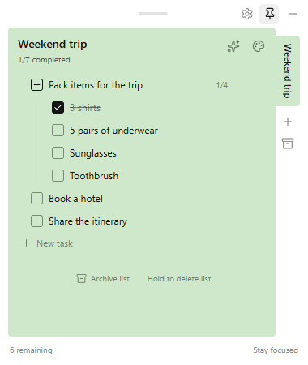

# Zen Todo

**English** · [简体中文](#简体中文)

A lightweight floating todo app with nested subtasks for Windows 10 and 11, built with Tauri 2, Rust, TypeScript, HTML and CSS.



*App preview with example tasks.*

## Features

- Keep multiple independent lists; archive them for later viewing and restoration, or hold the delete button for 1.5 seconds to delete a list.
- Organize tasks into nested subtasks. Parents appear above their indented children; each task can have its own subtasks. Check a parent to complete its whole subtree, or finish its subtasks individually and the parent completes automatically. Unchecking a child reopens its ancestors.
- Edit in place: Enter adds a sibling, Tab nests under the previous sibling, Shift+Tab lifts a task one level. Drag to reorder or drop onto another task to make it a subtask. Deleting a parent preserves and promotes its children.
- Use a compact, draggable, always-on-top window. Hide it to the system tray and restore it with a click; choose Quit from the tray to exit.
- Switch between English and Simplified Chinese in Settings. The settings window is borderless and can be dragged from its top edge.
- Optionally encrypt desktop data with a separate password and choose whether hiding to the tray locks the app.
- Use Ctrl+Z to undo manual, AI and CLI workspace edits, up to the last **20 operations**. Text editing is undone locally before workspace actions. Navigation does not consume history. Hiding to the tray clears all history; hidden-mode CLI edits do not retain snapshots.
- Use the ✨ button or Ctrl+K to create/edit lists with AI. AI first lists tasks, then breaks suitable tasks down into concrete subtasks. Configure an OpenAI-compatible endpoint or local Ollama under Settings → AI.
- External Agents can use the bundled `zen-todo-cli.exe` to read lists, submit changes, and undo. Reading and applying changes also work while hidden in the tray. See [AI and CLI usage](docs/ai-and-cli.md).

## Privacy and storage

Desktop data is stored in `%APPDATA%/com.zentodo.app/todos.json`. Encryption is **off by default**; enable it under **Settings → Privacy**. Zen Todo uses Argon2id to derive a key and AES-256-GCM to encrypt the lists. The password can be changed after entering the current password. **A forgotten encryption password cannot be recovered.**

When lock-on-hide is enabled, reopening from the tray requires the password, and unsent drafts are retained encrypted in the tray process. Old `todos.json.tmp` files, system backups, or other existing copies may still contain plaintext. Browser development mode stores data in localStorage and does not provide this encryption. Cross-device synchronization is not yet implemented.

## Development

Requirements: Node.js 22.18 or later, Rust stable, and the Windows WebView2 Runtime.

```bash
npm install
npm run dev          # browser development preview
npm test             # nested task and list tests
npm run build        # frontend build
cargo test --manifest-path src-tauri/Cargo.toml # Rust action, AI HTTP and encryption tests
cargo build --manifest-path src-tauri/Cargo.toml --bin zen-todo-cli # development CLI
npm run tauri dev    # desktop development
npm run tauri build  # Windows installer
```

The repository also includes a GitHub Actions workflow to build the Windows installer; download the `zen-todo-windows-installer` artifact from the workflow run.

The Windows installer builds and installs the console CLI next to the GUI executable. Invoke it by full path or add the install directory to your PATH. No model subscription is included: preset availability, quotas and prices depend on the provider. Ollama runs locally using your own hardware. API keys are kept in Windows Credential Manager; only endpoint and model preferences are written to `ai-settings.json`. AI requests send the active list and prompt to the selected endpoint, even if local file encryption is enabled.

---

## 简体中文

一个面向 Windows 10/11、可以嵌套子任务的轻量悬浮待办清单应用。使用 Tauri 2、Rust 和原生 HTML/CSS/TypeScript 构建。

## 当前功能

- 通过标签页创建、切换、重命名多个独立待办列表；点击顶部列表名称可编辑
- 可归档清单，在标签栏的归档按钮中查看并恢复；也可长按删除按钮 1.5 秒删除活跃或已归档的清单。归档或删除最后一个活跃列表时自动创建空白列表
- 待办是类似 Notion 的可编辑行，支持多层嵌套子任务；父任务在上，子任务缩进显示在下
- 勾选父任务会同时完成所有子任务；子任务全部完成后父任务自动完成；取消子任务会同步取消父任务及其祖先的完成状态
- 键盘：回车添加同级待办；Tab 设为前一个同级任务的子任务，Shift+Tab 提升一级并放到原父任务之后；空的新待办按 Backspace 删除；上下方向键在待办间移动
- 拖动左侧手柄：落在目标上/下边缘为调整同级顺序，落在中间则成为目标的子任务；拖动父任务会带上整棵子任务树，不能拖入自己的后代
- 悬停显示“添加子任务”和删除；删除父任务会保留子任务，并提升到父任务原来的位置
- 子任务始终显示，父任务旁显示直接子任务的完成进度
- 任务保存到用户数据目录，不依赖数据库；旧版保存的层级会自动作为父子关系读取，保留任务 ID、标题和创建时间，后续保存使用 `parentId`
- 无边框小窗口，支持拖动和始终置顶，整条顶部区域可拖动
- 顶部齿轮打开独立设置窗口，可切换简体中文 / English
- 桌面版可在设置中启用独立密码加密，并选择隐藏到托盘时是否锁定
- Ctrl+Z 可连续撤销最近 **20次清单操作**，统一包含手动、AI 和 CLI 修改；输入文字时优先撤销当前文字编辑，切换清单等纯导航不占用历史
- 成功隐藏到托盘后清空全部历史；隐藏期间的 CLI 修改不保留撤销快照，退出应用也会清空
- 点击便签头部 ✨ 或按 Ctrl+K，用自然语言创建和编辑清单，结果直接应用
- 设置 → AI 支持自定义 OpenAI 兼容接口、Ollama 本地模型及可编辑的服务商预设；支持保存配置和测试已保存的连接
- 外部 Agent 可通过安装目录中的 `zen-todo-cli.exe` 读取、修改与撤销；隐藏到托盘后仍可操作，保险库锁定时拒绝读取和修改。详见 [AI 与 CLI 使用说明](docs/ai-and-cli.md)
- 界面使用 Lucide SVG 图标，默认启用低内存托盘模式：收起时保存状态并销毁窗口，只保留托盘进程

在普通浏览器中运行时，数据保存在该浏览器的 localStorage；桌面应用使用本地文件。

## 设置与语言

点击右上角齿轮打开独立设置窗口，默认尺寸为 640×480，最小尺寸为 480×360，可通过窗口顶部空白区域拖动。窗口采用左侧分类、右侧设置内容的布局。重复点击齿轮会激活已有设置窗口；关闭设置窗口不会退出应用，也不影响主窗口使用。

在“通用 → 语言”中选择简体中文或 English，设置即时保存。语言偏好单独保存在 WebView / 浏览器的 `zen-todo-settings` 中，下次打开自动恢复。跨窗口通过 storage 事件与 Tauri 事件同步，切换语言不会修改已有列表名称和待办内容，也不会丢失主窗口中正在编辑的草稿。

普通浏览器开发模式下，设置会打开到独立的命名弹出窗口；也可以直接访问 `/?view=settings` 预览设置页面。

### AI 配置

内置 AI 和“复制提示词给你的 Agent”使用相同的清单规划原则：**先写一份任务清单，再尝试给每一条任务（如果可以的话）拆分出更详细的子任务。** 例如，“整理旅行需要携带的物品”可以包含“衬衫3件”“内裤5件”“太阳镜”“牙刷”。具体、简单的条目不必继续拆分。AI/CLI 推荐使用 `children` 嵌套数组表达层级，无需构造执行先后关系。

在“AI”分类选择服务预设，填写 Base URL、模型名称和 API Key，然后保存。Ollama 需先在本机安装并下载对应模型，例如 `ollama pull qwen2.5:7b`，通常无需 API Key。服务商预设只是可编辑示例，不保证模型持续可用或免费；请以服务商的实际额度和定价为准。

API Key 存在 Windows 凭据管理器中，不写入待办或普通配置文件；留空会保留已有密钥，切换预设时默认清除旧密钥，输入新密钥会取消清除。Base URL 和模型名称保存在数据目录的 `ai-settings.json`。测试连接仅发送一条简短测试消息，使用已保存配置，不发送待办。实际执行 AI 指令时，会将当前清单与指令发送到所选接口，即使开启了本地文件加密。

AI 生成期间仍可手动编辑；若数据已变化，旧生成结果会被拒绝应用。取消生成会丢弃本次结果，已发出的网络请求可能仍在服务端完成。手动、AI 和 CLI 修改共用最多20次的多级撤销历史，只有保存成功的操作才会记录；一次父子任务联动或一次 AI 更新整体算一次操作。历史只在内存中保留，成功隐藏到托盘或退出后清空，隐藏期间的修改不记录历史。

### 本地加密

桌面版默认不加密。在设置的“隐私 → 本地数据加密”中输入两次密码并开启后，应用使用 Argon2id 派生密钥，以 AES-256-GCM 加密所有列表。迁移时先验证密文，再通过临时文件替换 `todos.json`；后续保存的临时文件也只包含密文。密码不会保存到文件中，**忘记密码将无法恢复数据**，请使用可靠的密码管理方式。

重启应用需要输入密码。可在设置中开启“隐藏到托盘时锁定”，此时关闭或隐藏窗口后重新显示也需要密码；未提交的输入草稿会在托盘进程内以密文保留，解锁后恢复。关闭该选项时，应用在托盘运行期间保持解锁，直到退出应用。

加密开启后可在“隐私 → 本地数据加密”中修改密码；需要输入当前密码和两次新密码。应用验证原密码并以新密码重新加密，写入成功后才切换密钥。

加密文件带有版本和密钥派生参数，可在未来跨平台实现兼容读取；目前尚未实现同步。该功能不加密浏览器开发模式的 localStorage。旧版遗留的 `todos.json.tmp`、系统备份或其他已有副本可能仍包含明文，应用不会擅自删除这些文件；请根据需要自行检查处理。

顶部拖动区域已扩大为整窗宽 24px；列表名称下方的状态文字与标题栏空白处也可拖动，输入框和操作按钮保持原有交互。

## 低内存托盘模式

此模式默认开启，不提供开关。点击隐藏按钮或关闭主窗口时，应用会等待当前保存完成，再保存待办和界面快照，销毁主窗口及设置窗口的 WebView。没有窗口时，Rust 进程和系统托盘仍然运行；托盘菜单的“退出”才会结束应用。

点击托盘图标或“显示窗口”时，应用按原窗口配置重新创建主窗口，恢复当前列表、置顶状态、窗口位置和大小、滚动位置及待办输入草稿。设置窗口不自动重建。界面快照保留在托盘进程内存中；已保存待办仍写入 `todos.json`。保存失败时不会销毁主窗口，可继续编辑并重试。

## 开发环境

需要安装：

- Node.js 22.18+（支持直接运行 TypeScript 依赖规则测试）
- Rust stable（通过 `rustup` 安装）
- Windows WebView2 Runtime

安装依赖后运行前端：

```bash
npm install
npm run dev
```

运行任务层级规则测试及前端构建：

```bash
npm test
npm run build
```

运行桌面开发模式：

```bash
npm run tauri dev
```

构建 Windows 安装包：

```bash
npm run tauri build
```

## GitHub 云端构建

项目已包含 GitHub Actions 工作流。将代码推送到 GitHub 后，在仓库的 `Actions` 页面手动运行 `Build Windows Installer`，或推送到 `main`/`master` 分支自动构建。

构建完成后，在对应任务的 `Artifacts` 中下载 `zen-todo-windows-installer`，其中包含 Windows `.exe` 安装包。本地无需安装 Rust。

工作流会先从 `src-tauri/icons/icon.svg` 自动生成 Windows 安装包所需的图标文件。

数据保存在 `%APPDATA%/com.zentodo.app/` 下的 `todos.json` 中。
